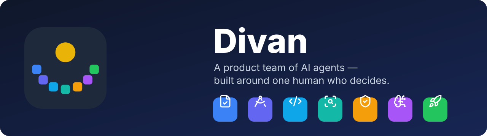
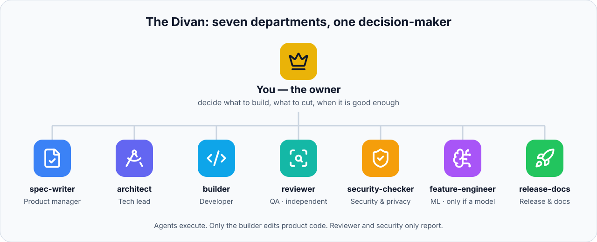
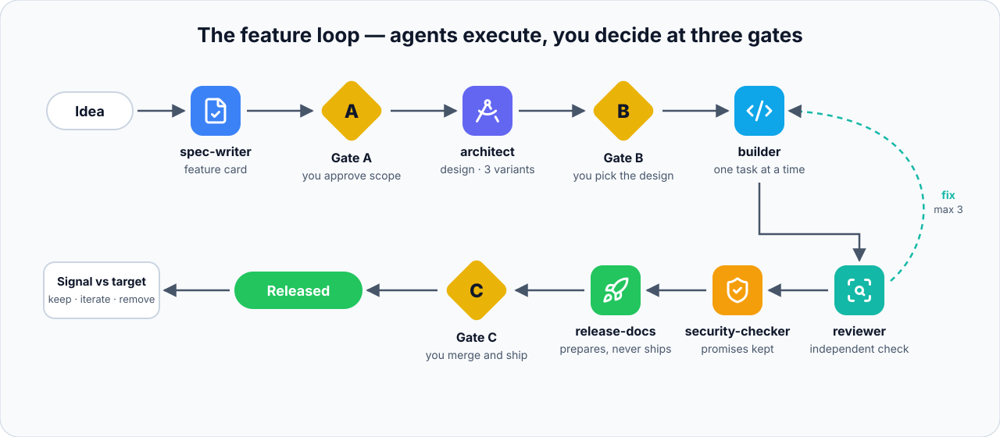

<p align="center">
  
</p>

<p align="center">
  <a href="README.md">English</a> · <a href="README.fa.md">فارسی</a> · <b>العربية</b> · <a href="README.zh-CN.md">中文</a>
</p>

<p align="center">
  
  
  
  
</p>

<div dir="rtl">

# ديوان

**فريق منتج من وكلاء الذكاء الاصطناعي لمشاريع البرمجيات — مبنيّ حول إنسان واحد يتخذ القرار.**

[المنهجية (بالإنجليزية)](docs/method.md) · [التكييف مع مستودع قائم (بالإنجليزية)](docs/adapting.md) · [دراسة حالة (بالإنجليزية)](docs/case-studies/taghvim.md) · [عن المؤلف](#about)

> **الحالة: مرحلة مبكرة (الإصدار 0.1).** جرى تثبيت ديوان وتكييفه على منتج حيّ واحد
> ([دراسة الحالة](docs/case-studies/taghvim.md)). لم تُنفَّذ **بعد** دورة كاملة من الفكرة إلى الإطلاق.
> عند تنفيذها ستُنشر النتائج هنا، بما في ذلك الإخفاقات.

---

## المشكلة

وكلاء البرمجة بالذكاء الاصطناعي سريعون، والسرعة ليست المشكلة. المشكلة أن الوكيل الواحد، حين يُطلب منه «ابنِ هذه الميزة»، يصبح في آنٍ واحد مدير المنتج والمعماري والمطوّر والمراجِع، **ثم يقيّم عمله بنفسه**. النتيجة: كثير من الشيفرة بسرعة، وبعضها يحلّ المشكلة الخطأ، أو يكسر قاعدة لم يخبره بها أحد، أو يُنشَر مباشرة على بيئة الإنتاج.

حلّت الفرق البشرية هذه المشكلة منذ زمن طويل عبر **أدوار منفصلة ونقاط موافقة**. ديوان يجلب هذا الهيكل نفسه إلى الوكلاء.

## الفريق

<p align="center">
  
</p>

| | الوكيل | المقابل البشري | يعدّل الشيفرة؟ |
|:-:|---|---|---|
|  | `spec-writer` | مدير المنتج — تعريف الميزات | لا |
|  | `architect` | القائد التقني — التصميم، ثلاثة بدائل، تقسيم العمل | لا |
|  | `builder` | مطوّر متكامل وتطبيقات جوّال، مهمة واحدة في كل مرة | نعم |
|  | `reviewer` | مهندس أول وضمان جودة — **مستقل** عن المطوّر | لا |
|  | `security-checker` | الأمن والخصوصية — يتحقق من وعود المنتج العلنية | لا |
|  | `feature-engineer` | مهندس تعلّم آلي — **فقط إذا كان للمنتج نموذج** | مجلد التعلّم الآلي فقط |
|  | `release-docs` | DevOps وكاتب تقني — يُحضّر ولا يُطلق أبدًا | التوثيق فقط |

إضافة إلى ذلك:
- **`feature-loop`**: العملية التي تربط الوكلاء، مع **ثلاث بوابات** يعود القرار فيها إليك.
- **`feature-definition`**: تحويل الطلبات إلى ميزات صغيرة قابلة للاختبار مع مؤشر نجاح.
- **`divan-adapt`**: تكييف الحزمة مع مستودع ناضج **دون كسر قواعده**.
- **خطّاف جودة (hook)**: يمنع الوكيل من إنهاء العمل ما دامت الاختبارات أو فحص الأنواع فاشلة.
- **قواعد منع**: لا push، ولا tag، ولا إطلاق، ولا قراءة لملفات `.env` أو مفاتيح التوقيع.

## الدورة

<p align="center">
  
</p>

- **البوابة A — النطاق:** توافق على بطاقة الميزة، بما في ذلك ما حُذف منها.
- **البوابة B — التصميم:** توافق على النهج وتختار أحد البدائل الثلاثة.
- **البوابة C — الإطلاق:** أنت من يدمج وينشر ويُطلق. الوكلاء لا يفعلون ذلك أبدًا.

## التثبيت

</div>

```bash
git clone --depth 1 https://github.com/farjadp/divan.git
./divan/install.sh /path/to/your/project
```

<div dir="rtl">

أداة التثبيت **لا تستبدل أي ملف موجود**. إذا كان في مشروعك ملف `CLAUDE.md`، يُكتب قالب ديوان بجانبه باسم `CLAUDE.divan.md` لتدمجه بنفسك. وتنبّهك إذا كان `.gitignore` يخفي مجلد `.claude/` أو إذا كان في المستودع تعليمات وكلاء سابقة (مثل `AGENTS.md`). استخدم `--dry-run` لترى ما ستفعله دون تغيير أي شيء.

بعد التثبيت:

1. املأ `CLAUDE.md`، وأهمّ ما فيه **القسم 2** (الحقائق الثلاث أدناه) و**القسم 4** (أوامر مشروعك الفعلية).
2. افتح المشروع في Claude Code ونفّذ `/agents` لترى الفريق.
3. **مشروع قائم؟** قل: *«adapt Divan to this repo»*.
4. قل: *«run the feature loop for: ميزة صغيرة وحقيقية»*.

## ثلاث حقائق يجب أن يعرفها كل وكيل

معظم إخفاقات فرق الوكلاء ليست أخطاء برمجية، بل وكيل كسر إحدى هذه الحقائق لأن أحدًا لم يكتبها:

1. **ما الذي يُطلق النشر على بيئة الإنتاج؟** إذا كان الدفع إلى `main` يعني النشر، فإن دفع الوكيل يعني إطلاقًا.
2. **ما سياسة التتبّع؟** هي التي تحدد كيف يُقاس النجاح. ديوان لا يضيف أي تتبّع إلى منتج وعد بعدم التتبّع.
3. **ما الوعود العلنية للمنتج؟** (مثل «لا طلبات إلى أطراف ثالثة» أو «يعمل دون اتصال».) يتحقق وكيل الأمن من كل تغيير مقابل كل وعد بالاسم.

## «تعريف الميزات» ليس «هندسة الميزات»

**هندسة الميزات (Feature Engineering)** مصطلح من التعلّم الآلي: بناء المتغيرات المُدخلة التي يتعلّم منها النموذج. أما تحويل احتياجات المستخدم إلى ميزات في المنتج فاسمه **تعريف الميزات (Feature Definition)**، وهو جزء من هندسة المتطلبات. يفصل ديوان بين الأمرين: وكلاء مختلفون ومصطلحات مختلفة.

## لماذا «ديوان»؟

في الحكومات الفارسية التاريخية كان «الديوان» هو الجهاز الإداري: أقسام متخصصة كديوان الرسائل وديوان الاستيفاء (المالية) وديوان العرض (الجيش)، يؤدي كل منها عملًا واحدًا بإتقان، وتعود جميعها إلى صاحب قرار واحد. هذا هو شكل هذا الفريق.

## حدود صريحة

- **اكتشاف احتياجات المستخدم مسؤوليتك.** الوكلاء لا يجرون مقابلات مع المستخدمين. قدّم لهم أدلة أو علّم الادعاءات بأنها افتراضات.
- **الذوق مسؤوليتك.** يُنتج الوكلاء تصميمًا مقبولًا، ونادرًا ما يكون ممتازًا.
- **الحسابات مسؤوليتك.** المتاجر والمدفوعات ومفاتيح التوقيع والشؤون القانونية للبشر وحدهم.
- **السرعة تُخفي الدَّين التقني.** إن لم تستطع شرح وحدة برمجية في دقيقتين، توقّف وراجِع.
- **التكلفة.** التشغيل الطويل للوكلاء يستهلك رموزًا كثيرة. المهام الصغيرة أرخص وأفضل.
- **الأدوات تتغيّر.** صيغ الوكلاء والمهارات والخطافات تتطور؛ راجعها مع [توثيق Claude Code الحالي](https://docs.claude.com/en/docs/claude-code/overview).

## المساهمة

أثمن مساهمة هي **تقرير استخدام حقيقي**: ثبّتّ ديوان على مشروع حقيقي؛ ما الذي تعارض، وما الذي تعطّل، وما الذي غيّرته؟ راجع [CONTRIBUTING.md](CONTRIBUTING.md).

---

<a id="about"></a>

## عن المؤلف


**فرجاد بورمحمد** استراتيجي في الذكاء الاصطناعي، ومرشد لريادة الأعمال، وصانع منتجات، يقيم في تورنتو بكندا. أمضى أكثر من عشرين عامًا في بناء شركات تقنية في إيران وكندا: أسّس شركة برمجيات وأدارها، وقاد فرقًا هندسية بصفته مديرًا تقنيًا (CTO)، وبنى منتجاته الخاصة، ومنها [تقويم](https://taghv.im)، وهو تقويم فارسي مفتوح المصدر للويب والمتصفحات والهواتف. يرشد اليوم مؤسسي الشركات الناشئة في مراحلها الأولى، ويساعد الشركات على تحديد المواضع التي يضيف فيها الذكاء الاصطناعي قيمة حقيقية. وُلد ديوان من هذا العمل: الانضباط نفسه الذي يطلبه من المؤسسين (عرّف المشكلة، قلّص النطاق، قِس النتيجة) مطبَّقًا على فريق من وكلاء الذكاء الاصطناعي.

*من التعقيد، إلى الوضوح، إلى الفعل.*

### الخدمات

| | الخدمة | الوصف |
|:-:|---|---|
| 🧭 | **استراتيجية الذكاء الاصطناعي** | أين يضيف الذكاء الاصطناعي قيمة حقيقية في عملك، ثم تصميمه وبناؤه وتأمينه. |
| 🚀 | **إرشاد الشركات الناشئة — The Founder Lab** | برنامج مجاني مدته ثمانية أسابيع لخمسة فرق: اكتشاف العملاء والتحقق من الفكرة قبل البناء. |
| 🤝 | **استشارات وتدريب للمؤسسين** | جلسات فردية: شريك تفكير للقرارات التي لا يتخذها أحد غيرك. |
| 🛠️ | **تطوير الويب والتطبيقات ومنتجات الذكاء الاصطناعي** | عبر AshaVid: مواقع، وإضافات متصفح، وتطبيقات أندرويد وآيفون، وودجات، وأتمتة. |
| 🔤 | **منتجات فارسية ومن اليمين إلى اليسار** | تخطيط صحيح من اليمين إلى اليسار، وخطوط، وأرقام فارسية، وتاريخ هجري شمسي، للمنتجات ذات المستخدمين الناطقين بالفارسية. |

**ابدأ بخطوة صغيرة:** مكالمة تشخيصية مجانية أو تقييم ذاتي مدته عشر دقائق على الموقع.

🌐 **[farjadp.info](https://farjadp.info)** ·
💼 [لينكدإن](https://www.linkedin.com/in/farjadpourmohammad) ·
▶️ [يوتيوب ‎@FarjadTalks](https://www.youtube.com/@FarjadTalks) ·
🐙 [غيت هب ‎@farjadp](https://github.com/farjadp)

---

## الترخيص

ترخيص MIT؛ راجع [LICENSE](LICENSE). رموز الوكلاء من [Lucide](https://lucide.dev) بترخيص ISC؛ راجع [assets/NOTICE-lucide.txt](assets/NOTICE-lucide.txt).

ديوان مشروع مستقل، ولا يرتبط بشركة Anthropic ولا يحظى بتأييدها. «Claude» و«Claude Code» علامتان تجاريتان لشركة Anthropic.

</div>
